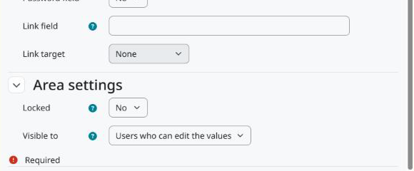

Configuration
=============

Go to *Site administration > Competencies*. There are two pages, one per area:

* *Learning plan template custom fields*: fields of every learning plan template.
* *Learning plan custom fields*: fields of every learning plan, created by hand or from a template.

Each page works like the course custom fields page: add a category to group the fields, then add the fields and choose their type.

   The area settings at the end of the field form.

Area settings
-------------

Locked
   Only users with ``tool/learningplancustomfields:changelockedcustomfields`` can edit the value.

Visible to
   * *Everyone*: everyone who can see the template or the plan, on its pages and through the web service. For a plan, that includes its owner.
   * *Users who can edit the values*: only users with ``tool/learningplancustomfields:edittemplate`` in the context of the template, or ``tool/learningplancustomfields:editplan`` in the user context of the plan owner.
   * *Nobody*: the value is not shown and not returned by the web service. Users who can edit the values still see it on the editing page.

Capabilities
------------

``tool/learningplancustomfields:configurecustomfields`` (system)
   Manage the fields of both areas. Manager by default.

``tool/learningplancustomfields:edittemplate`` (category)
   Edit the values of the templates in that context. Manager by default, and copied from ``moodle/competency:templatemanage`` on install.

``tool/learningplancustomfields:editplan`` (user)
   Edit the values of the plans of a user. Manager by default, and copied from ``moodle/competency:planmanage`` on install. Plan owners do not edit the values of their own plans unless a role gives them this capability.

``tool/learningplancustomfields:changelockedcustomfields`` (category)
   Edit locked fields. Manager by default.
