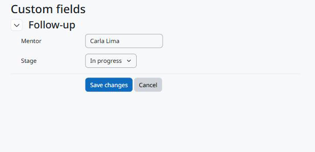

Usage
=====

Editing the values
------------------

The values and an *Edit custom fields* button appear at the top of these pages, for users who can edit the values:

* the template page (with its competencies) and the page that edits a template: values of the template;
* the plan page and the page that edits a plan: values of the plan.

Moodle does not let anyone edit a plan based on a template, so for those plans the values appear on the plan page only.

The button opens the common editing page of the Moodle Fields Suite. Save to go back to the template or the plan.

   Editing the values of a learning plan.

Users who cannot edit see only the values visible to them; when there are none, nothing is shown. The values of a template are not copied to the plans created from it.

Web service
-----------

``local_fieldssuite_get_values`` with ``component=tool_learningplancustomfields``, ``area=template`` (or ``plan``) and the ``instanceids`` returns, for each template or plan the user can see, the fields the user can see.

.. code-block:: bash

   curl "https://moodle.example/webservice/rest/server.php?wstoken=TOKEN&moodlewsrestformat=json&wsfunction=local_fieldssuite_get_values&component=tool_learningplancustomfields&area=plan&instanceids[0]=12"

Deleting
--------

Deleting a template or a plan deletes its values; deleting a user deletes the values of their plans. The fields stay.
