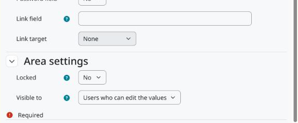

Configuração
============

Acesse *Administração do site > Competências*. Há duas páginas, uma por área:

* *Learning plan template custom fields*: campos de todos os modelos de plano de aprendizagem.
* *Learning plan custom fields*: campos de todos os planos de aprendizagem, criados à mão ou a partir de um modelo.

Cada página funciona como a dos campos personalizados do curso: crie uma categoria para agrupar os campos, depois os campos e o tipo de cada um.

   As configurações da área no fim do formulário do campo.

Configurações da área
---------------------

Bloqueado
   Só usuários com ``tool/learningplancustomfields:changelockedcustomfields`` podem editar o valor.

Visível para
   * *Todos*: todos que podem ver o modelo ou o plano, nas páginas deles e pelo web service. No caso do plano, isso inclui o dono.
   * *Usuários que podem editar os valores*: só usuários com ``tool/learningplancustomfields:edittemplate`` no contexto do modelo, ou ``tool/learningplancustomfields:editplan`` no contexto de usuário do dono do plano.
   * *Ninguém*: o valor não aparece nem é devolvido pelo web service. Quem pode editar os valores continua vendo-o na página de edição.

Permissões
----------

``tool/learningplancustomfields:configurecustomfields`` (sistema)
   Gerenciar os campos das duas áreas. Gerente, por padrão.

``tool/learningplancustomfields:edittemplate`` (categoria)
   Editar os valores dos modelos naquele contexto. Gerente, por padrão, e copiada de ``moodle/competency:templatemanage`` na instalação.

``tool/learningplancustomfields:editplan`` (usuário)
   Editar os valores dos planos de um usuário. Gerente, por padrão, e copiada de ``moodle/competency:planmanage`` na instalação. O dono do plano não edita os valores dos próprios planos, a menos que um papel lhe dê essa permissão.

``tool/learningplancustomfields:changelockedcustomfields`` (categoria)
   Editar campos bloqueados. Gerente, por padrão.
