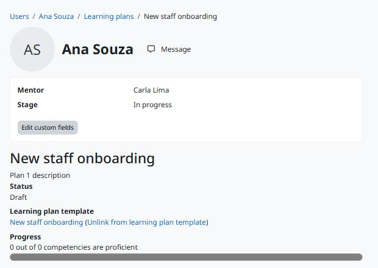

moodle-tool_learningplancustomfields
====================================

**Campos personalizados para modelos e planos de aprendizagem: gerencie como os campos personalizados do curso, edite os valores a partir das páginas do plano e leia-os em integrações.**

   Os valores de um plano de aprendizagem, com o link para editá-los.

* **Campos onde o Moodle não tem.** O Moodle tem campos personalizados para cursos, coortes e grupos, mas não para planos de aprendizagem. Esta ferramenta acrescenta duas áreas: modelos de plano de aprendizagem e planos de aprendizagem.
* **Todos os tipos de campo.** Texto, área de texto, menu, caixa de seleção, data e qualquer outro tipo instalado no site, com as configurações de sempre.
* **Controle de quem vê cada valor.** Cada campo é visível para todos, só para quem pode editar os valores ou para ninguém.
* **Privacidade desde o projeto.** Os valores do plano pertencem ao dono do plano: são exportados e excluídos pela Privacy API, e excluídos junto com o usuário.
* **Pronto para integrações.** O web service ``local_fieldssuite_get_values`` devolve os valores que o usuário pode ver.

Faz parte da `Moodle Fields Suite <https://moodle-fields-suite.github.io>`_; requer o `local_fieldssuite <https://moodle-fields-suite.github.io/local_fieldssuite/>`_.

English version: `English <../en/index.html>`_.

.. toctree::
   :maxdepth: 2
   :caption: Conteúdo

   installation
   configuration
   usage
   privacy

Links
-----

* Código-fonte e issues: https://github.com/moodle-fields-suite/tool_learningplancustomfields
