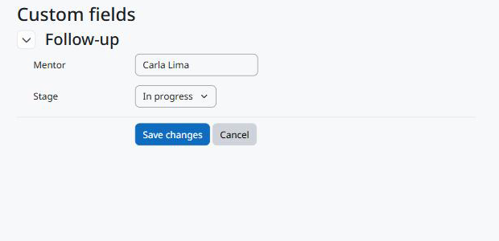

Uso
===

Editando os valores
-------------------

Os valores e um botão *Edit custom fields* aparecem no topo destas páginas, para quem pode editar os valores:

* a página do modelo (com as competências dele) e a página que edita um modelo: valores do modelo;
* a página do plano e a página que edita um plano: valores do plano.

O Moodle não permite editar um plano baseado em modelo; nesses planos, os valores aparecem só na página do plano.

O botão abre a página comum de edição da Moodle Fields Suite. Ao salvar, você volta ao modelo ou ao plano.

   Editando os valores de um plano de aprendizagem.

Quem não pode editar vê só os valores visíveis para si; quando não há nenhum, nada aparece. Os valores de um modelo não são copiados para os planos criados a partir dele.

Web service
-----------

``local_fieldssuite_get_values`` com ``component=tool_learningplancustomfields``, ``area=template`` (ou ``plan``) e os ``instanceids`` devolve, para cada modelo ou plano que o usuário pode ver, os campos que ele pode ver.

.. code-block:: bash

   curl "https://moodle.exemplo/webservice/rest/server.php?wstoken=TOKEN&moodlewsrestformat=json&wsfunction=local_fieldssuite_get_values&component=tool_learningplancustomfields&area=plan&instanceids[0]=12"

Excluindo
---------

Excluir um modelo ou um plano exclui os valores dele; excluir um usuário exclui os valores dos planos dele. Os campos continuam.
